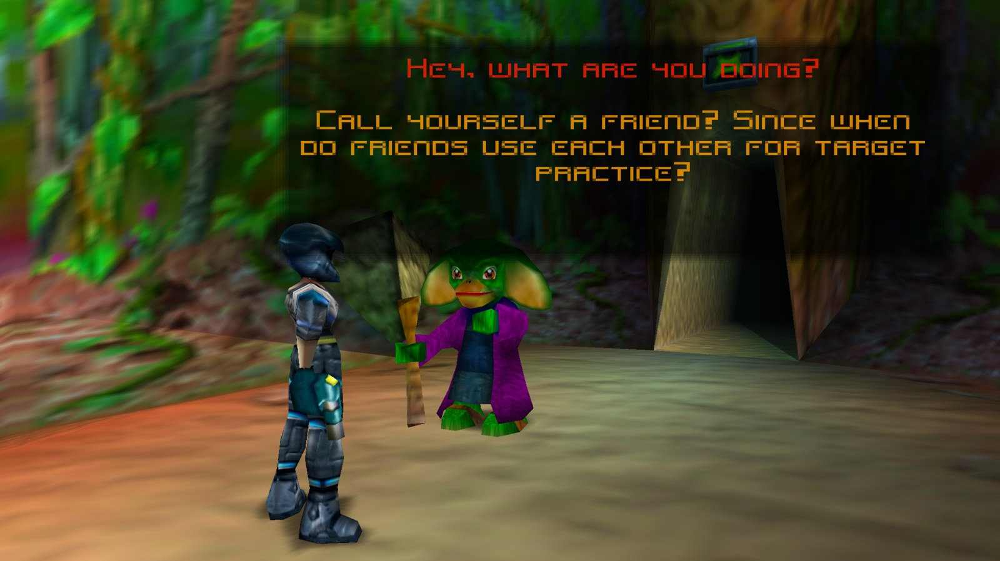
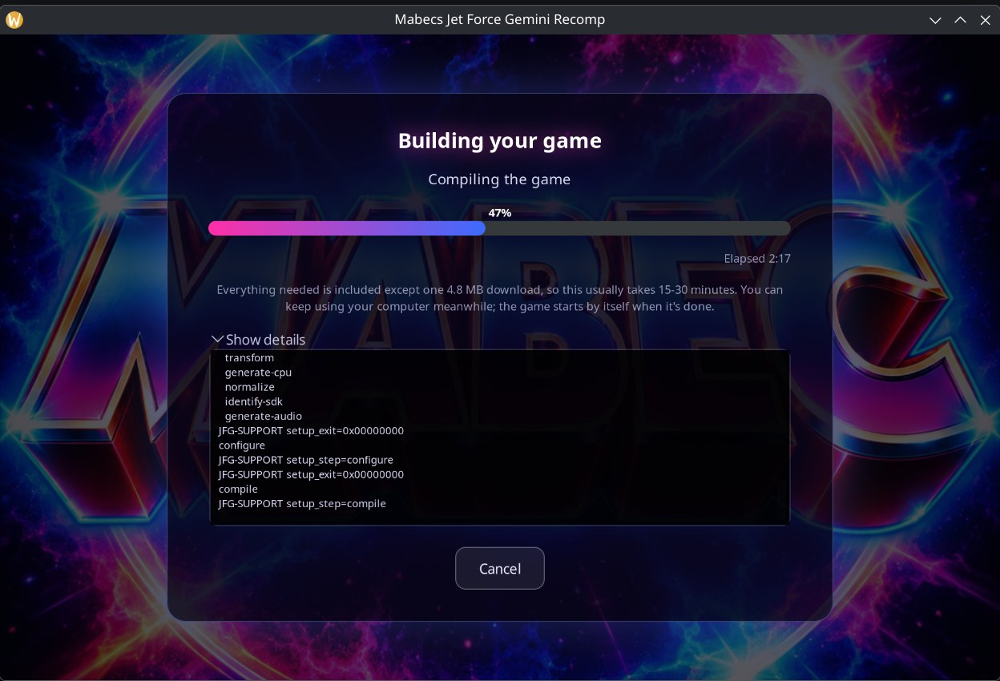

# Mabecs Jet Force Gemini Recomp (Linux)



An unofficial Linux edition of [Jet Force Gemini Recomp](https://github.com/TK22-26/JetForceGemini-Recomp)
by TK22-26 and the JFG Recomp contributors. Double-click the AppImage, choose your
Jet Force Gemini (USA) ROM, and the game is built on your computer and starts by
itself. Later launches go straight to the game.



## Download: choose one

| | **Standard** ([JFG-Linux-Ver1](https://github.com/Mabec-games/JetForceGemini-Recomp/releases/tag/JFG-Linux-Ver1)) | **Offline** ([JFG-Linux-Ver2](https://github.com/Mabec-games/JetForceGemini-Recomp/releases/tag/JFG-Linux-Ver2)) |
|---|---|---|
| AppImage size | 3.7 MB | 144 MB |
| Downloaded during the first build | about 4 GB | about 6 MB (the IDO compiler and the decompilation) |
| First build takes | an hour or more, depending on your connection | about 15–30 minutes |
| Good for | fast, reliable internet | slow or unreliable internet |

Both build the same game and use the same saves.

```
chmod +x JFG-Linux-mabec*.appimage
./JFG-Linux-mabec-offline.appimage      # or ./JFG-Linux-mabec.appimage
```

## You need

- **Your own Jet Force Gemini (USA) `.z64` ROM.** The launcher checks it.
- **Common build tools.** If any are missing, the launcher lists them with the
  install command for your distribution.
- **Python 3.11–3.14** for the offline edition's Python packages to come from the
  AppImage (other versions download them).

## What's different from upstream

- A first-run launcher window: choose your ROM, see progress, and get readable
  errors with **Try again**.
- Fixes the Linux build failing on GCC (reported upstream as
  [issue #15](https://github.com/TK22-26/JetForceGemini-Recomp/issues/15)).
- Stalled downloads stop after 60 seconds instead of hanging, and downloads try
  IPv4 first, for routers that never answer IPv6 lookups.
- Includes [NoahVl's Linux AppImage improvements](https://github.com/NoahVl/JetForceGemini-Recomp/tree/claude/linux-appimage)
  (GTK 3 requirement check, first compiler errors on a failed build).
- Window title: "Mabecs Jet Force Gemini Recomp".

No ROM, game data or code generated from a ROM is included in this repository or
its releases. Two things are never bundled and are downloaded on first launch:
IDO, the original N64 compiler, which is proprietary, and the Jet Force Gemini
decompilation, which is reconstructed game code without a license. Everything the
offline edition bundles is open source; its license files are in the AppImage
under `usr/share/jfg-recomp/offline/licenses`. Not affiliated with or endorsed by
the upstream project, Rare or Nintendo.

---

*The original project's README follows.*

# Jet Force Gemini Recomp

[](https://github.com/TK22-26/JetForceGemini-Recomp/actions/workflows/ci.yml)

A native PC recompilation of Jet Force Gemini for Windows x64.
Experimental Linux x86-64 support is documented in [Linux support](docs/development/linux.md).
**v1.1.0** includes a prebuilt game: extract the ZIP, import your supported
North American ROM once, and click **Play**. No developer tools or compilation
are required.

**Campaign status: fully playable from start to finish** through maintainer
playtesting. See the playtesting notes below for the conditions of that run.

[Get started](docs/getting-started.md) · [Changelog](CHANGELOG.md) ·
[Known issues](docs/known-issues.md) · [Report a problem](docs/playtesting.md) ·
[Contribute](CONTRIBUTING.md)

## Installation

Download **JFG-1.1.0-windows-x64.zip** from the
[v1.1.0 release](https://github.com/TK22-26/JetForceGemini-Recomp/releases/tag/v1.1.0),
extract the entire ZIP, and open `JFG-Launcher.exe`. Use **Select ROM…** to import
your supported US `.z64` ROM. Once import finishes, the original file can be
moved or deleted; the launcher uses its private local copy. Existing saves
stay in your game profile. **Game > Select ROM…** remains available afterward.

The installation approach is inspired by the **Zelda64Recomp team** and
[Zelda64Recomp's plug-and-play distribution model](https://github.com/Zelda64Recomp/Zelda64Recomp#plug-and-play).
Credit to that project for this setup experience; this is an independent
implementation, with no endorsement or affiliation implied.

**We do not ship game assets or ROMs.** The release includes the compiled game
program and runtime libraries. Textures, models, audio, and other game data are
read from your locally imported ROM, which is never uploaded. Original game
content remains the property of its respective owners.

Version 1.1.0 also restores a centered 4:3 game area so cutscene bars remain
correct inside a wide launcher window. See the [changelog](CHANGELOG.md).

## What works

- Full campaign completion, verified through maintainer playtesting.
- Optional live map and live inventory tracking in a custom companion interface.
- Native rendering and audio.
- Keyboard controls and configurable Xbox/XInput controllers.
- **Experimental PC controls (single-player):** mouse-and-keyboard look/aim and
  dual-stick controller support, including movement and strafing while aiming.
  Enable experimental controls for your selected device in the launcher's
  Controller Mapping window. See [PC controls status and remaining work](docs/planning/pc-controls-status.md).
- Verified saving and loading, with a launcher for setup and subsequent launches.

Original-console accuracy remains under validation.
Playtesting continues across more PCs, controllers, and gameplay.
See [recent gameplay fixes](docs/development/boot-gameplay-fix.md) and
[development progress](docs/dashboard.md) for details.

## Campaign playtest progress

**Campaign status: fully playable from start to finish**
through maintainer playtesting.

The verification run used optional infinite-health and enemy auto-kill testing
mods, plus a testing save with all Tribals unlocked. Saving and loading are
also verified.

## Live map and inventory

Optional companion tools provide a custom interface for exploring the game
and tracking your progress:

- **Live map:** see your position, room exits, items, NPCs, enemies, Tribals,
  and doors. Select an object to inspect its requirements and rewards; zoom,
  pan, or fit the map to the current room.
- **Live inventory:** track weapons, keys, quest items, and shared ship parts.
  View Juno, Vela, or Lupus, or follow the active character automatically.


*Live map in the custom companion interface.*

The inventory's game icons are extracted locally from each player's own ROM;
those artwork files are not bundled with the project or launcher. The interface
is custom project code. Game content remains the property of its respective
owners.

See the [launcher and live tools guide](docs/development/launcher.md) for details.

## Getting started

Start with the [getting started guide](docs/getting-started.md) for requirements,
downloads, and setup. You need a supported US big-endian `.z64` ROM;
the project does not provide ROMs or game assets.

The [released bundle](https://github.com/TK22-26/JetForceGemini-Recomp/releases)
is ready to play after ROM import. Developers can still build from source;
the guide explains both paths. Older v1.0 setup issues are documented in
[known issues](docs/known-issues.md#windows-10-setup).

## Help by playtesting

Play normally and report problems: crashes, freezes, progression blockers,
incorrect controls, graphics or audio, and save/load failures. Check
[known issues](docs/known-issues.md) first and attach the launcher's support
ZIP when available. Successful sessions do not need a report.

See [playtesting and reporting](docs/playtesting.md). If you want to contribute
code, [CONTRIBUTING.md](CONTRIBUTING.md) explains the pull request workflow.

## Future additions

The goal is a complete, faithful PC version of Jet Force Gemini with optional
modern enhancements. Planned work and remaining validation include:

- **Original local multiplayer and optional content:** broader coverage of the
  modes and activities beyond the main campaign.
- **Ultrawide support:** wider aspect ratios with correct gameplay presentation,
  menus, and HUD layout.
- **Higher frame-rate presentation:** smoother visuals while preserving the
  original gameplay timing.
- **Mod support:** documented interfaces and tools for community modifications.
- **A more polished PC experience:** smoother setup, broader controller coverage,
  and better crash and freeze diagnostics.

Compatibility and stability come first. These are development goals; release
dates have not been set.

## Build and development status

- [Build status and CI runs](https://github.com/TK22-26/JetForceGemini-Recomp/actions/workflows/ci.yml)
- [Development progress](docs/dashboard.md)
- [Build the playable game from your ROM](docs/development/rom-bootstrap.md)
- [Build and test the project source](docs/development/setup.md)
- [Documentation index](docs/README.md) and [project roadmap](docs/planning/JFG_RECOMP_MASTER_PLAN.md)

CI checks source, tools, and tests without a ROM. A passing build does not
establish that every level or gameplay feature works.

## License

Original project code and documentation use the [MIT License](LICENSE).
Dependencies retain their [third-party notices](THIRD_PARTY_NOTICES.md).
Jet Force Gemini game content and trademarks belong to their respective owners.
